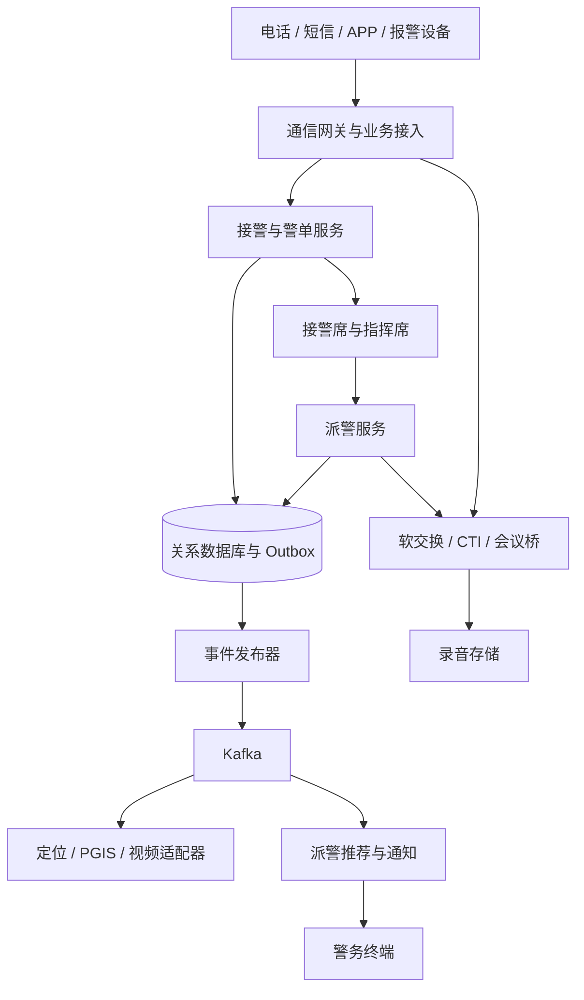

# 架构设计文档

## 1. 文档定位与范围

本设计以根目录 README.md 为需求输入，面向 110 接处警、指挥调度和跨系统联动。当前仓库仅有方案说明，无业务代码、可执行构建或部署清单；本文描述拟建架构，不代表生产能力或合规认证已经完成。

业务目标是呼入后并行获取辅助信息、形成警单、推荐警力并开展处置。接警连续性优先于智能分析和外部资源完整性。“10 秒派警、60 秒到场”、切换小于 3 秒均为 README 中的愿景或候选指标，须按地区、线路、警力密度和实测结果确定；到场时间不能由软件单独保证。

## 2. 系统边界与分层

| 层次 | 组成 | 职责与边界 |
| --- | --- | --- |
| 接入层 | PSTN/SIP 网关、CTI、12110、APP、设备适配器 | 电话保持原生通信链路；短信和应用请求转换为统一业务模型，不强行转换为 SIP |
| 核心业务层 | 接警、警单、派警、警力、预案、协同 | 管理警情状态和派遣决定，提供人工确认与干预入口 |
| 通信调度层 | 软交换、会议桥、录音接口 | 使用 SIP/CTI 专用控制通道，隔离于业务消息队列 |
| 数据支撑层 | 关系数据库、Kafka、缓存、录音对象存储 | 保存业务事实、传播事件、提供临时查询和证据存储 |
| 外部集成层 | PGIS、定位、视频、警综、警务终端、联动单位 | 通过受控适配器连接，处理授权、超时、限流与协议差异 |
| 应用层 | 接警席、指挥席、移动终端、运维台 | 按角色和辖区展示数据，所有关键操作审计 |

图中数据库到发布器表示读取已提交的 Outbox 记录，并非数据库直接向 Kafka 发消息。外部资源返回结果经业务接口或结果事件回写，必须关联警单和请求版本。

## 3. 部署与容灾原则

采用“双中心 + 分布式接入”的目标形态。接入和无状态服务可多实例运行；双中心是否同时承载业务，取决于运营商路由、数据库复制能力、跨中心时延和专网条件。不能仅靠部署两套应用宣称双活。

首期建议单一写入中心、备用中心恢复接管。按辖区或业务分片扩展时，每个分片仍有唯一写入所有者。中心切换须具备租约、隔离旧主及通信路由接管步骤，防止双重派警。数据库同步复制可用于中心内高可用；跨中心复制模式及数据损失窗口必须经验证。

通信系统的存量通话保持、录音完整性与业务服务恢复分别验收。业务应用切换成功不意味着通话无损迁移。网络分区时暂停无法确认所有权的自动派警，保留人工接警及应急调度渠道。

## 4. 技术与代码组织

后续 Java 工程设定 JDK 17，优先 Maven 多 module：

| 拟建模块 | 职责 |
| --- | --- |
| alarm-contracts | API、事件 Schema、错误码和兼容规则 |
| alarm-domain | 警单、派遣状态机与业务规则 |
| alarm-application | 用例编排、事务、权限与幂等 |
| alarm-infrastructure | 数据库、Kafka、Outbox、外部协议适配 |
| alarm-server | HTTP/事件入口、运行配置和启动 |

先以模块化单体明确事务边界，再按容量和隔离需求拆分服务。Gradle 构建方案可放独立分支，须与 Maven 对齐 JDK、依赖及验证任务。新增代码时同时补齐 GitHub Actions，使用 gh 查看真实运行结论；本文档提交不创建没有工程可构建的占位工作流。

持久化采用支持事务、唯一约束及备份恢复的关系数据库；最终产品与版本通过兼容性和采购要求确定。Kafka 用于事件广播和汇聚；是否对接上级平台及其协议以实际接口合同为准。首期不额外引入 RabbitMQ，延迟重试由持久化任务表承载。缓存不可作为警单或派遣事实的唯一存储。

## 5. 一致性与可靠性

警单变更和 Outbox 事件在同一数据库事务提交，发布器确认 Kafka 写入后标记发送状态。崩溃恢复可能重复发布，因此按至少一次投递设计。以 incidentId 为分区键提供分区内顺序，另以 aggregateVersion 检测重复、旧版本和缺口，不假定跨分区全局有序。

消费去重键为 consumerName + eventId，并与业务副作用在同一数据库事务内提交。外部终端或通信调用无法加入本地事务，使用稳定 commandId、持久化执行状态、查询对账和人工处理，不能承诺端到端恰好一次。消费失败采用有上限的重试和隔离队列；补发保留原事件标识与审计轨迹。

Kafka 故障时，已提交警单及待发事件保留在数据库。受理和人工调度是否继续，按通信链路与派遣持久化可用性判断；异步辅助功能显示延迟。数据库不可写时进入经演练的人工应急流程，禁止界面显示虚假受理成功。

## 6. 安全与业务控制

接警席采用双因子认证、最小权限、辖区与角色访问控制；服务间认证和传输加密覆盖网关、数据库、消息队列和存储。手机号、精确位置等字段按分类规则加密或脱敏，日志与事件默认仅携带业务标识，密钥由独立密钥管理设施托管。

报警接入须有防拥堵、限速、溢流和人工复核机制，不能因算法判断恶意呼叫便永久阻断紧急求助。三方通话、跨部门共享、视频调取和自动派警均应有授权策略、操作审计及可回退路径。语音识别和敏感词识别提供辅助建议，重大决策须有明确的人工作业规则。

审计使用独立权限域、追加写入与具备防篡改能力的归档存储。等保、密码应用、数据共享及录音保留周期由适用制度和主管方确认；README 中 180 日或一年不能直接视为普遍法定期限。

## 7. 可观测性与架构验收

统一关联 callId、incidentId、dispatchId、eventId 和 traceId，分别监测呼入接通、警单提交、推荐产生、派遣确认、终端回执时延，以及 Outbox 最老未发送时长、消费积压、录音缺片、复制延迟。

架构验收至少覆盖：节点退出、Kafka 中断、数据库主备切换、跨中心断网、外部接口超时、终端离线、重复事件、乱序事件、录音恢复和备份恢复。记录负载、测量起止点、失败比例和 P95/P99；目标值须在压测与业务确认后冻结。

## 8. 待决事项

上线前确定业务容量与忙时模型、通信厂商接口、部署网络边界、数据库与 Kafka 版本、自动派警授权范围、RTO/RPO、录音留存周期及跨部门共享规则。详见[概要设计](概要设计文档.md)与[部署文档](部署文档.md)。
