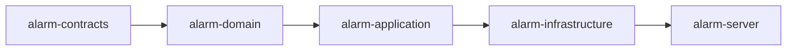
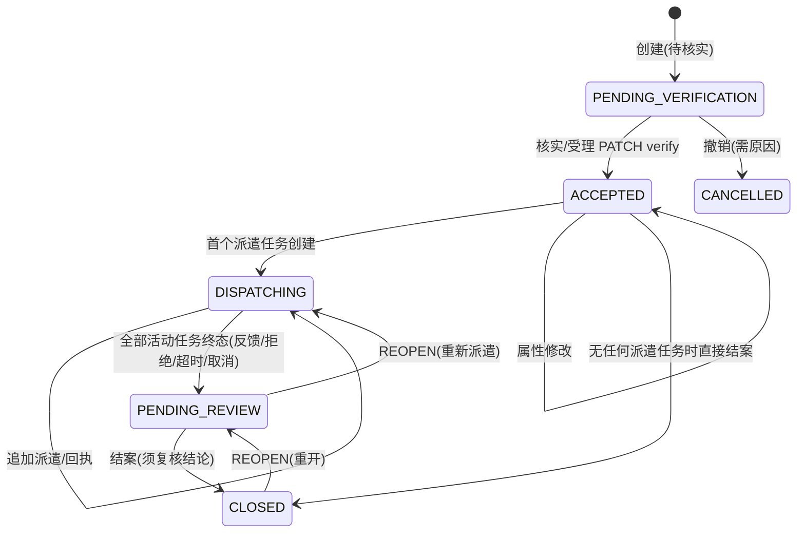
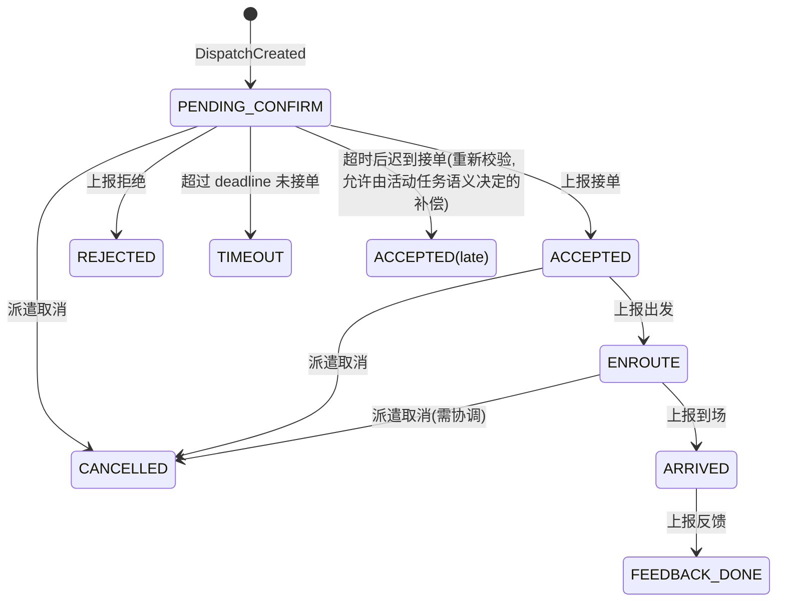
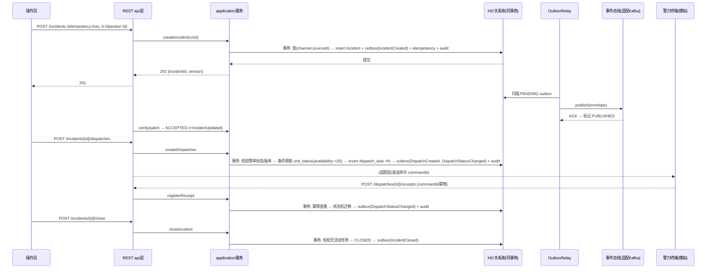
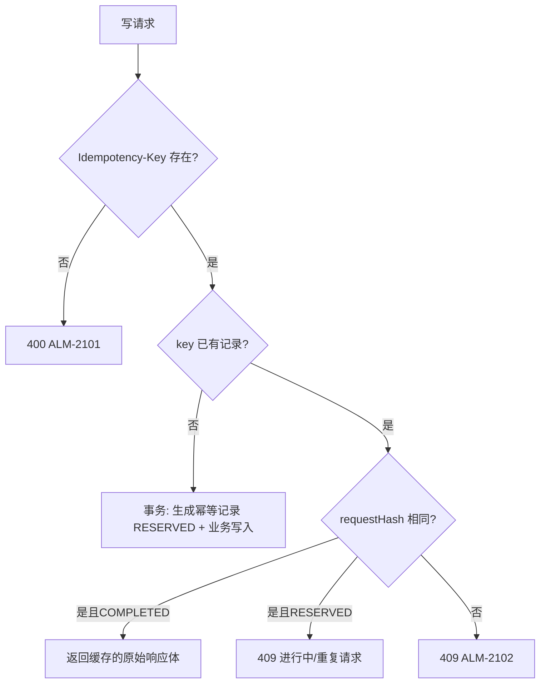

# 详细设计文档

## 1. 文档定位

本文承接[架构设计](架构设计文档.md)与[概要设计](概要设计文档.md)，给出可直接编码实现的模块划分、领域模型、数据库表结构、REST 接口出入参、事件载荷与数据流程图。实现代码与本文同步落地；实现完成后以 `docs/测试方案.md` 描述测试与验收方法。

当前首版实现范围（明确声明）：

- 已实现：警单受理/核实/修改/结案、派遣任务创建与回执、警力状态与推荐、幂等控制、乐观锁版本控制、Outbox 事件落库与补发器。
- 模拟实现：事件发布采用内存总线 + 日志（`LogEventPublisher`），对外留出 Kafka 适配位，不承诺真实 Kafka 集群；通信 CTI/录音、定位、PGIS、视频为端口定义 + 假适配器。
- 未实现：真实警力终端、真实通信线路、鉴权对接（使用请求头模拟操作人）、双中心切换。

## 2. 工程结构与模块划分

Maven 多 module，JDK 17，父 `pom.xml` 统一管理依赖版本：

| 模块 | 职责 | 依赖 |
| --- | --- | --- |
| alarm-contracts | REST 出入参 DTO（record）、事件信封与事件类型、统一错误码 | 无外部依赖 |
| alarm-domain | 警单/派遣/警力聚合、状态机、领域规则、仓储接口|x 无外部依赖 |
| alarm-application | 用例编排（受理、派遣、回执、结案）、事务边界、幂等、Outbox、推荐引擎、端口接口 | spring-context、spring-tx、jackson-databind |
| alarm-infrastructure | JDBC（JdbcTemplate）仓储实现、Outbox 数据访问与补发器、事件发布适配（日志模拟）、系统时钟与 ID 生成 | spring-boot-starter-jdbc、H2 |
| alarm-server | Spring Boot 启动类、REST 控制器、异常映射、schema.sql、应用配置 | 全部模块 + spring-boot-starter-web + test |

依赖方向：`server → infrastructure → application → domain → contracts`，不允许反向依赖。



## 3. 领域模型与状态机

### 3.1 聚合

| 聚合/实体 | 类 | 关键字段 | 不变量 |
| --- | --- | --- | --- |
| 警单 | `Incident` | id、channel、sourceId、status、priority、verifiedAddress、locationRef、createdBy、version、createdAt、updatedAt | (channel, sourceId) 全局唯一；version 单调递增；状态迁移只经状态机 |
| 派遣任务 | `DispatchTask` | id、incidentId、unitId、commandId、status、deadline、assignedBy、version、timestamps | commandId 全局唯一；同一 incident 下同一 unit 同时至多一条活动任务（非终态） |
| 警力状态 | `UnitStatus` | unitId、name、capabilities、availability、location、observedAt、version、lastDispatchId | availability 数值 0~100（0=不可用）；位置过期判断以服务端时钟 |
| Outbox 事件 | `OutboxEvent`（infra） | eventId、type、incidentId、aggregateId、aggregateType、aggregateVersion、payload(JSON)、traceId、state、createdAt、publishedAt | 与业务变更同事务 inser；state: PENDING/PUBLISHED |
| 幂等记录 | `IdempotencyRecord`（infra） | key、scope、operation、requestHash、responseBody、responseStatus、state、createdAt | (scope, key) 唯一；同 key 同摘要返回缓存结果，不同摘要返回 409 |
| 审计记录 | `AuditRecord`（infra） | id、actorId、action、targetType、targetId、detail、occurredAt | 追加写入 |

### 3.2 警单状态机



约束：
- `ACCEPTED` 之前不允许创建派遣任务（已受理才可正式派遣）。
- `CLOSED` 需要：无活动派遣任务（非终态集合 = {PENDING_CONFIRM, ACCEPTED, ENROUTE, ARRIVED}）且提供 `conclusion`。
- `CANCELLED` 需要权限检查 + 原因；有活动任务时返回 409，须先取消任务。

### 3.3 派遣任务状态机



约束：
- 回执按 `commandId` 幂等：同 commandId 重复回执返回原结果，不产生新事件。
- `TIMEOUT` 为系统任务扫描产生（离线/未确认），迟到接单需重新校验目标警单仍处于 DIS..<搁置置>——首版实现中，超时由派警服务主动检查接口 `POST /dispatches/state-tasks/run` 触发扫描：将过期且仍为 PENDING_CONFIRM 的任务置为 TIMEOUT 并产生 DispatchStatusChanged 事件。
- 终态集合 = {FEEDBACK_DONE, REJECTED, TIMEOUT, CANCELLED}。
- 回执消息携带 `expectedVersion`，条件更新冲突返回 409。

### 3.4 乐观锁与警力预约

- `Incident.version`、`DispatchTask.version`、`UnitStatus.version` 均为乐观锁版本号。所有写操作 SQL 带 `WHERE version = ?`，影响行数为 0 时抛出 `OptimisticLockConflictException` → HTTP 409。
- 警力预约：创建派遣任务时，在同一事务内对 `UnitStatus` 做条件更新（`availability = availability - 20`，负数则失败），保证两个并发派遣不能同时吃掉同一个警力名额；失败即返回 409/422。

## 4. 数据库表设计（H2 语法 / 同构映射到生产关系库）

```sql
-- 警单
CREATE TABLE incident (
    id              VARCHAR(36) PRIMARY KEY,
    channel         VARCHAR(16)  NOT NULL,   -- PHONE/SMS/APP/DEVICE
    source_id       VARCHAR(64)  NOT NULL,   -- 渠道内业务幂等标识 callId 等
    status          VARCHAR(24)  NOT NULL,   -- PENDING_VERIFICATION/ACCEPTED/DISPATCHING/PENDING_REVIEW/CLOSED/CANCELLED
    priority        VARCHAR(8)   NOT NULL,   -- LOW/MEDIUM/HIGH/CRITICAL
    type            VARCHAR(32)              NOT NULL,
    description     VARCHAR(512),
    verified_address VARCHAR(256),         -- 人工核实地址（受理前允许为空，VERIFY 时必填）
    location_ref    VARCHAR(64),             -- 定位引用(与人工地址分开)
    conclusion      VARCHAR(512),            -- 结案复核结论
    created_by      VARCHAR(64)  NOT NULL,
    version         BIGINT       NOT NULL DEFAULT 0,
    created_at      TIMESTAMP    NOT NULL,
    updated_at      TIMESTAMP    NOT NULL,
    closed_at       TIMESTAMP,
    CONSTRAINT uk_incident_source UNIQUE (channel, source_id)
);

-- 派遣任务
CREATE TABLE dispatch_task (
    id             VARCHAR(36) PRIMARY KEY,
    incident_id    VARCHAR(36) NOT NULL,
    unit_id        VARCHAR(64) NOT NULL,
    command_id     VARCHAR(64) NOT NULL,
    status         VARCHAR(24) NOT NULL,  -- PENDING_CONFIRM/ACCEPTED/ENROUTE/ARRIVED/FEEDBACK_DONE/REJECTED/TIMEOUT/CANCELLED
    note           VARCHAR(256),
    assigned_by    VARCHAR(64) NOT NULL,
    deadline       TIMESTAMP   NOT NULL,
    version        BIGINT      NOT NULL DEFAULT 0,
    created_at     TIMESTAMP   NOT NULL,
    updated_at     TIMESTAMP   NOT NULL,
    CONSTRAINT uk_dispatch_command UNIQUE (command_id)
);
CREATE INDEX idx_dispatch_incident ON dispatch_task(incident_id);

-- 警力状态
CREATE TABLE unit_status (
    unit_id         VARCHAR(64) PRIMARY KEY,
    name            VARCHAR(64) NOT NULL,
    capabilities    VARCHAR(128) NOT NULL,   -- 逗号分隔: PATROL,ARMED,FIRST_AID
    availability    INT          NOT NULL,   -- 0~100
    location_x      DOUBLE       NOT NULL,
    location_y      DOUBLE       NOT NULL,
    observed_at     TIMESTAMP    NOT NULL,
    last_dispatch_id VARCHAR(36),
    version         BIGINT       NOT NULL DEFAULT 0
);

-- outbox 事件
CREATE TABLE outbox_event (
    event_id          VARCHAR(36) PRIMARY KEY,
    event_type        VARCHAR(48) NOT NULL,
    incident_id       VARCHAR(36),
    aggregate_id      VARCHAR(36) NOT NULL,
    aggregate_type    VARCHAR(24) NOT NULL,
    aggregate_version BIGINT      NOT NULL,
    payload           CLOB        NOT NULL,
    trace_id          VARCHAR(64),
    state             VARCHAR(12) NOT NULL,   -- PENDING/PUBLISHED
    created_at        TIMESTAMP   NOT NULL,
    published_at      TIMESTAMP
);
CREATE INDEX idx_outbox_state ON outbox_event(state, created_at);

-- 幂等记录
CREATE TABLE idempotency_record (
    scope           VARCHAR(96) NOT NULL,   -- actor:operation
    key             VARCHAR(64) NOT NULL,
    operation       VARCHAR(48) NOT NULL,
    request_hash    VARCHAR(64)  NOT NULL,
    response_body   CLOB,
    response_status INT,
    state           VARCHAR(12) NOT NULL,   -- RESERVED/COMPLETED
    created_at      timESTAMP   NOT NULL,
    CONSTRAINT uk_idempotency UNIQUE (scope, key)
);

-- 审计
CREATE TABLE audit_record (
    id          VARCHAR(36) PRIMARY KEY,
    actor_id    VARCHAR(64) NOT NULL,
    action      VARCHAR(48) NOT NULL,
    target_type VARCHAR(24) NOT NULL,
    target_id   VARCHAR(64) NOT NULL,
    detail      VARCHAR(512),
    occurred_at TIMESTAMP   NOT NULL
);
```

## 5. REST API 详细出入参

通用约定：
- 基础路径 `/api/v1`；`Content-Type: application/json`。
- 请求头 `X-Operator-Id` 必填（操作人，模拟认证，后续接真实 IDP）；写接口要求 `Idempotency-Key` 头（除 GET 外）。
- 时间统一 ISO-8601 UTC 字符串，如 `2026-10-29T02:01:00Z`。
- 统一错误正文：`{"code":"ALM-xxxx","message":"...","details":[...]}`；禁止包含敏感正文。
- 分区排序和 tracked：响应头带 `X-Trace-Id`（透传或生成）。

### 5.1 POST /api/v1/incidents — 创建（登记）警单

| 项 | 说明 |
| --- | --- |
| 幂等 | Idempotency-Key 必须；同 key 同请求体返回 201/200 原结果；同 key 不同请求体 → 409 ALM-2102 |
| 成功 | 201 Created，返回 `{incidentId, status:"PENDING_VERIFICATION", version}` |
| 重复来源 | (channel, sourceId) 已存在 → 201 返回已有 incidentId（防重复建单） |

请求体：

```json
{
  "channel": "PHONE",
  "sourceId": "CALL-20261029-0001",
  "priority": "HIGH",
  "type": "ROBBERY",
  "description": "现场有人持刀抢劫",
  "location": { "x": 116.397428, "y": 39.909230, "source": "CELL", "observedAt": "2026-10-29T02:01:00Z" }
}
```

| 字段 | 类型 | 必填 | 约束 |
| --- | --- | --- | --- |
| channel | enum | 是 | PHONE/SMS/APP/DEVICE |
| sourceId | string(1..64) | 是 | 渠道内唯一呼叫/报文标识 |
| priority | enum | 是 | LOW/MEDIUM/HIGH/CRITICAL |
| type | string(1..32) | 是 | 业务类型代码 |
| description | string(<=512) | 否 | 报警描述 |
| location | object | 否 | x/y 为坐标（WGS84 语义由调用方定义），observedAt 必须晚于 1970 |
| location.source | enum | - | CELL/GPS/AGPS/WIFI |
| location.observedAt | datetime | - | 定位采集时间 |

响应 201：

```json
{ "incidentId": "..."
, "status": "PENDING_VERIFICATION", "version": 0 }
```

### 5.2 GET /api/v1/incidents/{id}

| 项 | 说明 |
| --- | --- |
| 成功 | 200 完整警单（含 dispatches 概要列表） |
| 失败 | 404 ALM-1004 |

响应示例：

```json
{
  "incidentId": "…", "channel": "PHONE", "sourceId": "…",
  "status": "DISPATCHING", "priority": "HIGH", "type": "ROBBERY",
  "description": "…", "verifiedAddress": "…",
  "location": { "…": "" },
  "createdBy": "OPER-01", "version": 3,
  "createdAt": "…", "updatedAt": "…",
  "dispatches": [
    { "dispatchId": "…", "unitId": "U-01", "status": "ACCEPTED", "version": 1 }
  ]
}
```

### 5.3 PATCH /api/v1/incidents/{id} — 核实/修改警单

| 项 | 说明 |
| --- | --- |
| 幂等 | Idempotency-Key 必须 |
| 成功 | 200 返回新 status/version；并产生 IncidentUpdated 事件 |
| 冲突 | expectedVersion 不匹配 → 409 ALM-1002 |

请求体（字段可选，至少一项）：

```json
{
  "expectedVersion": 1,
  "action": "VERIFY",                  // VERIFY(受理)/UPDATE(普通修改)/CANCEL(撤销)
  "priority": "CRITICAL",
  "type": "ROBBERY",
  "description": "…",
  "verifiedAddress": "北京市东城区X街X号",
  "location": { "…": "" },
  "reason": "核实地址与类型"             // VERIFY/CANCEL 时必填
}
```

| 字段 | 必填 | 说明 |
| --- | --- | --- |
| expectedVersion | 是 | 当前版本，条件更新 |
| action | 是 | VERIFY/UPDATE/CANCEL |
| reason | action in (VERIFY, CANCEL) 必填 | 审计原因 |
| 其余字段 | 否 | 不动即保持 |

### 5.4 POST /api/v1/incidents/{id}/dispatches — 创建派遣任务

| 项 | 说明 |
| --- | --- |
| 前置 | 警单必须已 ACCEPTED 且非 CANCELLED/CLOSED |
| 幂等 | Idempotency-Key 必须；同 key 同请求返回原结果 |
| 事件 | DispatchCreated（每条任务一个），同时 DispatchStatusChanged 并由警单聚合版本推进 |

请求体：

```json
{
  "expectedVersion": 2,
  "unitIds": ["U-01", "U-02"],
  "note": "现场需增援",
  "deadlineSeconds": 60
}
```

| 字段 | 必填 | 约束 |
| --- | --- | --- |
| expectedVersion | 是 | 警单当前版本 |
| unitIds | 是 | 1..5 个；每个必须存在、availability>=20、位置观测过期(bit)警示但不禁止；同一警单下不允许对同一 unit 重复创建活动任务 |
| note | 否 | <=256 |
| deadlineSeconds | 否 | 默认 60；30..600 |

响应 201：

```json
{
  "incidentVersion": 3,
  "dispatches": [
    { "dispatchId": "…", "unitId": "U-01", "commandId": "…", "status": "PENDING_CONFIRM",
      "deadline": "…", "version": 0 }
  ],
  "warnings": ["UNIT_LOCATION_STALE"]
}
```

失败：409（版本冲突/状态机冲突/警力可用性不足）、404、400。

### 5.5 POST /api/v1/dispatches/{id}/receipts — 终端回执（幂等登记）

请求体：

```json
{
  "commandId": "…",
  "targetStatus": "ACCEPTED",       // ACCEPTED/REJECTED/ENROUTE/ARRIVED/FEEDBACK_DONE
  "expectedVersion": 0,
  "note": "已接单",
  "occurredAt": "2026-10-29T02:01:20Z"
}
```

| 项 | 说明 |
| --- | --- |
| 幂等 | 同 dispatchId + commandId 重复提交返回原结果（200），不产生重复事件 |
| 成功 | 200 `{dispatchId, status, version}`；产生 DispatchStatusChanged |
| 校验 | targetStatus 必须是合法迁移；report-holder 的 expectedVersion 不匹配 → 409 |
| 副作用 | FEEDBACK_DONE 时如果该警单无活动任务 → 警单进入 PENDING_REVIEW |

### 5.6 POST /api/v1/dispatches/{id}/cancel — 取消派遣

请求：`{ "expectedVersion": 0, "reason": "…" }`；仅非终态可取消（ENROUTE 取消允许，但必须记录原因）。产生 DispatchStatusChanged(CANCELLED)。

### 5.7 POST /api/v1/incidents/{id}/close — 结案

请求：`{ "expectedVersion": 4, "conclusion": "…", "reopenedFrom": null }`

| 项 | 说明 |
| --- | --- |
| 前置 | 警单处于 PENDING_REVIEW；无活动派遣任务；提供 conclusion |
| 幂等 | Idempotency-Key 必须 |
| 成功 | 200 `{incidentId, status:"CLOSED", version}`；产生 IncidentClosed |

### 5.8 POST /api/v1/units — 登记/更新警力状态

请求：

```json
{
  "unitId": "U-01", "name": "巡逻01",
  "capabilities": ["PATROL", "ARMED"],
  "availability": 80,
  "location": { "x": 116.39, "y": 39.91, "observedAt": "…" }
}
```

幂等（按 unitId upsert + version 乐观更新），产生无事件（内部状态表）。响应 200 `{unitId, version}`。

### 5.9 推荐与运维接口

- `POST /api/v1/incidents/recommendations-preview`：`{ incidentId(或坐标), radiusMeters(默认500) }` → 候选列表（unitId、distance、availability、位置观测时间、警告）。只读，不写状态。
- `POST /api/v1/ops/outbox/run`：触发一次 Outbox 补发扫描（返回发送数量），供测试与运维演进成内部定时器。
- `POST /api/v1/ops/dispatch-timeout/run`：触发一次派遣超时扫描（PENDING_CONFIRM 且已过期 → TIMEOUT）。

### 5.10 错误码

| HTTP | code | 场景 |
| --- | --- | --- |
| 400 | ALM-0901 | 参数格式/枚举非法、请求体缺失 |
| 400 | ALM-2101 | 缺少 Idempotency-Key 或 X-Operator-Id |
| 401 | ALM-1101 | 未认证（当前模拟：缺 X-Operator-Id） |
| 403 | ALM-1102 | 无权限（预留，当前仅角色校验预留接口） |
| 404 | ALM-1004 | 警单/派遣/警力不存在 |
| 409 | ALM-1002 | 乐观锁版本冲突 |
| 409 | ALM-1003 | 状态机不允许的状态迁移（含警力可用性竞争） |
| 409 | ALM-2102 | 幂等键冲突（同 key 不同请求体） |
| 422 | ALM-1005 | 业务校验失败（如 deadlineSeconds 越界、无可用候选、结案缺复核结论） |
| 500 | ALM-9999 | 未分类服务端错误 |
| 503 | ALM-1301 | 依赖不可用（预留：数据库/事件总线不可用时） |

## 6. 事件设计

事件信封（`EventEnvelope`）：

```json
{
  "eventId": "uuid",
  "eventType": "DispatchCreated",
  "schemaVersion": 1,
  "occurredAt": "2026-10-29T02:01:00Z",
  "aggregateType": "DISPATCH",
  "aggregateId": "dispatch-uuid",
  "aggregateVersion": 0,
  "incidentId": "incident-uuid",
  "traceId": "trace-…",
  "payload": { "…": "…" }
}
```

| eventType | 主要负载字段 | 消费者 |
| --- | --- | --- |
| IncidentCreated | channel, sourceId, priority, type | 定位/地图/转写适配器、数据汇聚 |
| IncidentUpdated | action, status, changedFields[], reason | 接警台、推荐引擎、汇聚 |
| DispatchCreated | dispatchId, unitId, commandId, deadline | 通知适配器、协同服务 |
| DispatchStatusChanged | dispatchId, unitId, from, to, note | 接警台、指挥台、汇聚 |
| IncidentClosed | conclusion, closedBy, closedAt | 归档、统计、汇聚 |

设计约束：
- 事件 payload 不包含录音内容与完整敏感住址，仅有业务标识与类型。
- 同 incident 的事件在 Outbox 中带单调 `aggregateVersion`（警单版本），消费端可据此检测缺口与重复。
- 发布为至少一次；消费幂等键 = consumerName + eventId。

## 7. 关键数据流程图

### 7.1 受理 → 派遣 → 回执 → 结案 主链路



### 7.2 Outbox 补发流程

```mermaid
flowchart TD
    A[业务事务: 数据+Outbox同库提交] --> B[PENDING]
    B --> C{Relay扫描}
    C -- publish成功 --> D[PUBLISHED(至少一次)]
    C -- 总线不可用 --> B
    D --> E[消费端按 consumerName+eventId 去重]
    B -- 积压/重新注入(崩溃恢复) --> C
```

### 7.3 幂等判定流程



## 8. 领域规则关键实现点（决策记录）

| 编号 | 决策 |
| --- | --- |
| D1 | 状态机校验放在 domain 层（`IncidentStateTransitions`），application 层只负责调用与事务，禁止在控制器写状态逻辑 |
| D2 | 乐观锁 file-level 注解不使用 JPA `@Version`（避免托管态副作用），由 application 层显式 `WHERE version=?` 更新并检测影响行数，映射 `OptimisticLockConflictException` → 409 |
| D3 | 幂等记录与业务写使用同一事务，保证“提交即幂等生效”；进程重启依据数据库记录而非内存 |
| D4 | 警力可用性预占通过条件 UPDATE 实现，避免在 Java 层加锁；失败映射 `UnitUnavailableException` → 409 |
| D5 | 撤销/取消/重开所有例外路径都必须带 `reason`，且写审计记录 |
| D6 | 定位结果 `observedAt` 只与人工核实地址分开保存，更新 location 不覆盖 verifiedAddress；位置过期仅在响应内 warning，不阻塞派警 |

## 9. 配置项

| 环境变量 | 默认 | 说明 |
| --- | --- | --- |
| SERVER_PORT | 8080 | HTTP 端口 |
| SPRING_DATASOURCE_URL | jdbc:h2:mem:alarm;DB_CLOSE_DELAY=-1 | 数据库连接 |
| ALARM_DISPATCH_DEFAULT_TIMEOUT_SECONDS | 60 | 派遣接单默认时限 |
| ALARM_OUTBOX_BATCH_SIZE | 100 | Outbox 扫描批量 |
| ALARM_RECOMMEND_RADIUS_DEFAULT_M | 500 | 推荐默认半径 |
| ALARM_UNIT_LOCATION_STALE_SECONDS | 120 | 位置过期阈值 |

## 10. 与测试方案的接口

实现验收依据见 [测试方案.md](测试方案.md)，至少覆盖：重复呼入不重复建单、同派遣 idempotency-key 重试不新增任务、并发派遣警力唯一预占、Outbox 崩溃恢复补发、版本冲突 409、状态机非法迁移拒绝、迟到回执、审计留痕、警单重开路径。
